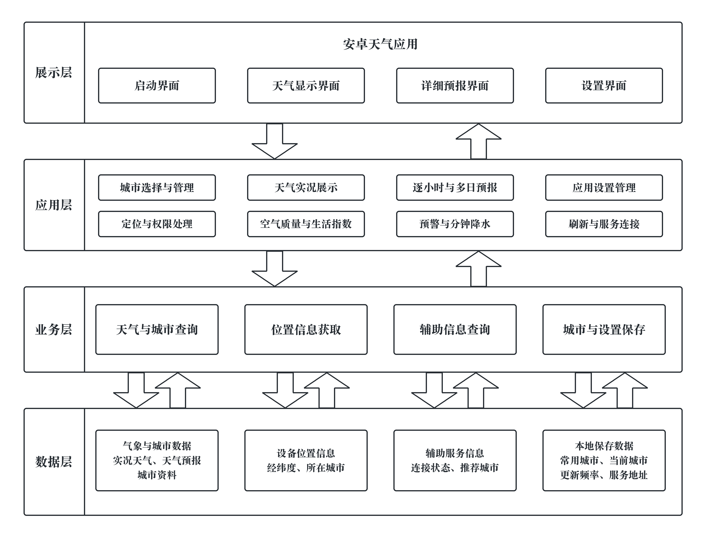
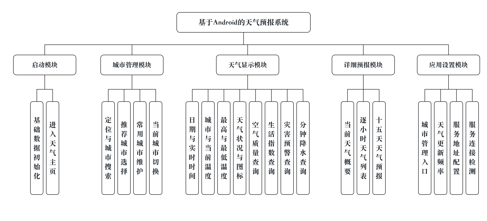
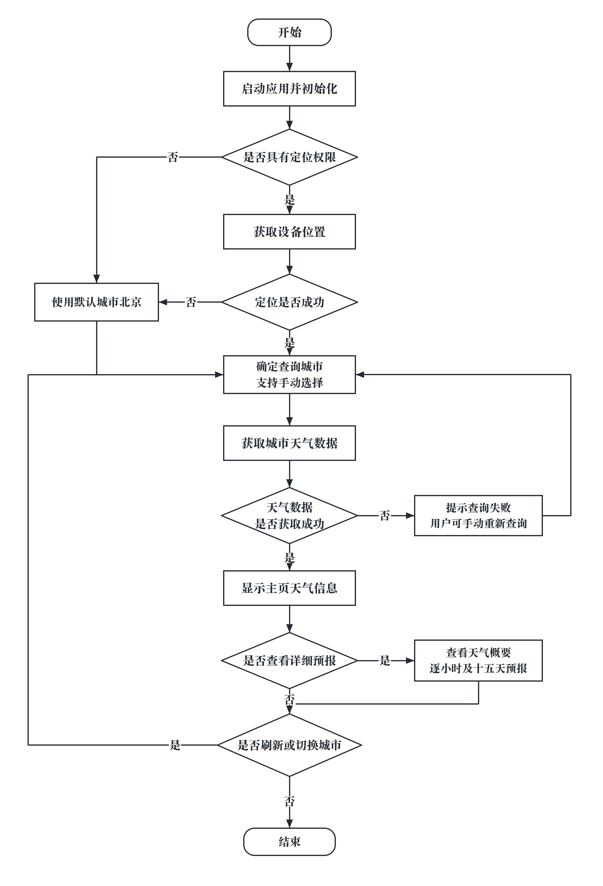
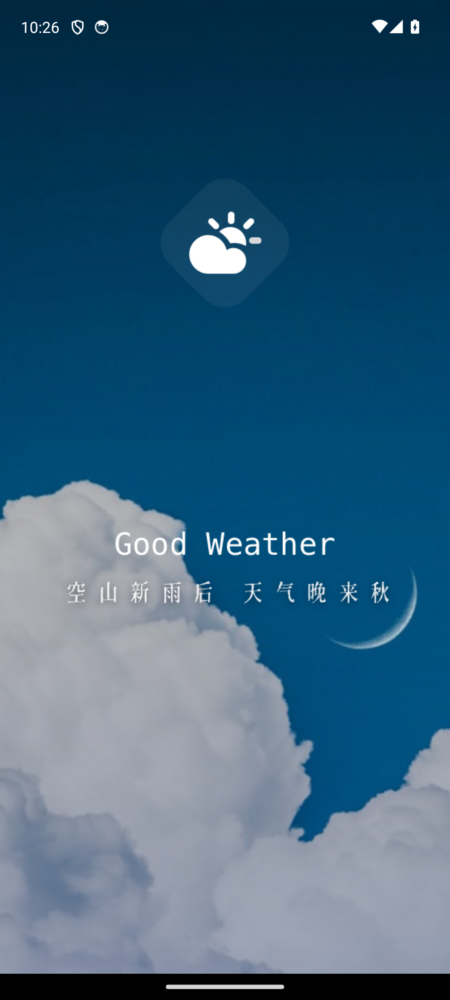
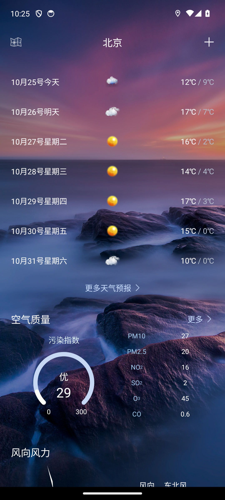
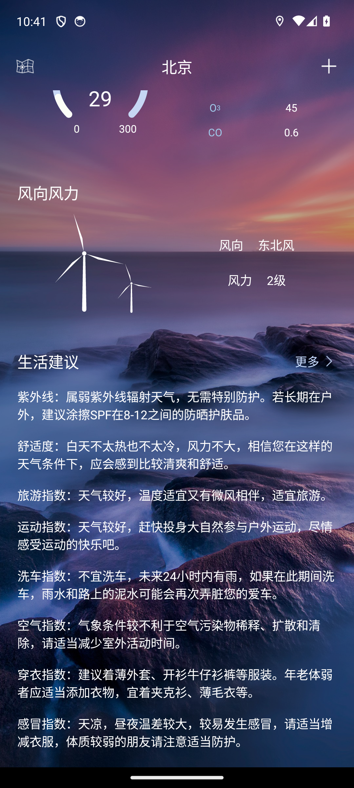
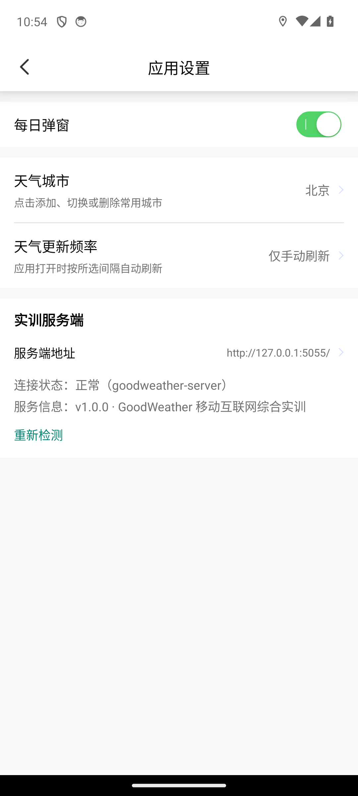

# 国家开放大学软件学院实践类课程综合考核材料

## 课程及科目信息

| 项目 | 内容 | 项目 | 内容 |
|---|---|---|---|
| 课程类别 | 实训实习(见习)类 | 课程ID | 05039 |
| 课程名称 | 综合实训(软件技术) | 试卷号 | 待填写 |
| 实践学期 | 26秋 |  |  |

## 学生信息

| 项目 | 内容 | 项目 | 内容 |
|---|---|---|---|
| 所在学习中心 | 待填写 | 入学批次 | 待填写 |
| 专业 | 软件技术 | 学号 | 待填写 |
| 姓名 | 待填写 |  |  |

## 综合考核评分信息

| 项目 | 内容 |
|---|---|
| 综合评分数 | 待填写 |
| 综合评分人(签字) | 待填写 |

## 评分依据材料目录

| 序号 | 材料名称 |
|---|---|
| 1 | 国家开放大学软件学院学生实践类课程考核表 |
| 2 | 附件、报告正文 |
| 3 | 待填写 |
| 4 | 待填写 |
| 5 | 待填写 |

说明：所有相关材料作为附件附后存档，并在本目录中逐项填写。相关材料除“考核表”外，包括但不限于实践报考、实践单位证明等。

<!-- pagebreak -->

# 国家开放大学软件学院学生实践类课程考核表

| 实践单位名称 | 实践起止日期 | 实践主题 |
|---|---|---|
| 待填写 | 2026.10.15-11.20 | 基于Android的GoodWeather天气预报系统设计与实现 |

指导（辅导）教师情况：此项不写。

| 姓名 | 工作单位 | 学历 | 专业 | 专业技术职务 |
|---|---|---|---|---|
| 此项不写 | 此项不写 | 此项不写 | 此项不写 | 此项不写 |

## 实践报告（由学生填写）

**[摘要]**
随着移动互联网的发展，用户对及时、准确和便捷的天气信息服务提出了更高要求。本文以GoodWeather天气预报系统为研究对象，旨在设计并实现一套集城市管理、天气查询和预报展示于一体的Android应用。系统采用Java语言和MVP架构，利用Retrofit、OkHttp与和风天气API获取天气数据，并通过LitePal和SharedPreferences保存常用城市及应用设置；Flask服务端负责提供运行状态、项目说明和推荐城市数据。本文按照需求分析、系统设计、功能实现、接口联调和功能测试的过程开展实践，实现了城市定位与切换、实时天气、24小时预报、7/15天预报、空气质量、生活指数、分钟降水和定时更新等功能。系统将当前时间与天气数据更新时间分别显示，并支持自动识别可访问的局域网服务地址。测试结果表明，系统主要功能运行正常，界面信息完整，具有较好的实用性和可维护性。

**[关键词]** 天气预报；城市管理；Android；和风天气；Flask

**[正文]** 报告正文单独附后。

学生（签名）：待填写

日期：待填写

<!-- pagebreak -->

## 实践评价

| 评价主体 | 出勤 | 实践态度 | 实践能力与效果 | 签章/日期 |
|---|---|---|---|---|
| 实践单位（35天） | 待填写 | 待填写 | 待填写 | 实践单位（章）：待填写；日期：待填写 |
| 指导（辅导）教师 | 此项不写 | 此项不写 | 此项不写 | 指导（辅导）教师（签字）：此项不写；日期：此项不写 |

<!-- pagebreak -->

# 附件：实践报告正文

# 基于Android的GoodWeather天气预报系统设计与实现

<!-- pagebreak -->

# 摘   要

随着移动互联网的发展，用户对及时、准确和便捷的天气信息服务提出了更高要求。本文以GoodWeather天气预报系统为研究对象，旨在设计并实现一套集城市管理、天气查询和预报展示于一体的Android应用。系统采用Java语言和MVP架构，利用Retrofit、OkHttp与和风天气API获取天气数据，并通过LitePal和SharedPreferences保存常用城市及应用设置；Flask服务端负责提供运行状态、项目说明和推荐城市数据。本文按照需求分析、系统设计、功能实现、接口联调和功能测试的过程开展实践，实现了城市定位与切换、实时天气、24小时预报、7/15天预报、空气质量、生活指数、分钟降水和定时更新等功能。系统将当前时间与天气数据更新时间分别显示，并支持自动识别可访问的局域网服务地址。测试结果表明，系统主要功能运行正常，界面信息完整，具有较好的实用性和可维护性。

**关键词：** 天气预报；城市管理；Android；和风天气；Flask

# 一、绪论

## （一）研究背景与意义

天气状况与人们的出行安排、衣着选择、生产活动和健康管理密切相关。气象数据的应用价值不仅体现在预报信息本身，也体现在面向具体场景的信息服务中。赵瑞等以智能网格天气预报为案例讨论了公共数据要素的价值转化，为理解天气数据的服务价值提供了研究背景[1]。随着智能手机的普及，用户获取天气信息的方式逐渐由电视、广播和网页转向移动应用。移动端天气应用能够结合用户所在城市，展示当前天气、温度变化和未来预报，为日常生活提供直观、便捷的信息服务。

天气数据具有更新频率高、内容种类多和位置相关性强等特点。张卫民等对中国数值天气预报业务系统的发展进行了梳理，相关研究构成了天气信息服务的数据生产背景[2]。面向用户的天气应用则需要将这些预报信息组织为城市查询、逐小时预报、多日预报及生活服务等内容，同时处理定位权限、网络访问、本地数据保存和页面状态同步等问题。因此，设计并实现GoodWeather天气预报系统，有助于综合运用Android界面开发、网络通信、数据解析、本地存储和服务端接口等知识，也能够提高移动应用的分析、设计与实现能力。

## （二）国内外研究现状

国内相关研究涉及天气预报发展趋势、预报数据处理和新型预测方法等方面。张丽亚等围绕全球气象预报的发展态势、现状与展望进行了讨论，为了解天气服务的技术背景提供了参考[3]。雷荔傈等研究了数值天气预报资料同化的发展，反映了观测资料与预报模型之间的联系[4]。吴玉对DeepMind人工智能天气预报模型进行了介绍，体现了人工智能在天气预测领域的应用探索[5]。这些文献主要关注天气数据的生成与预测技术，与本文侧重移动端信息展示的研究内容有所区别。

国外研究还涉及观测影响评估、机器学习与物联网监测。Samrat等通过资料剔除试验研究英国气象局全球数值天气预报系统中的观测影响[6]；Hamad等讨论了机器学习与物联网在实时天气预报系统中的结合[7]；Christopher等研究了结合物联网和Android的气体、温度、湿度及天气监测系统[8]。上述研究说明，天气服务既包括预报模型与数据处理，也包括环境信息采集和终端展示。

在天气服务系统建设方面，孟庆涛等研究了全球天气监测预报服务系统的设计与实现，为本文了解天气监测、预报与服务系统之间的关系提供了参考[9]。

现有研究为天气数据获取和移动端展示提供了较成熟的基础，但具体应用仍需解决多接口数据组织、城市状态同步、刷新频率设置和局域网服务连接等问题。本文不研究气象预测算法，而是利用现有天气数据接口，重点完成Android客户端的功能整合、页面展示和辅助服务连接，使用户能够在一个应用中查看城市天气及相关生活信息。

## （三）相关技术介绍

客户端采用Java在Android平台开发，通过Gradle管理依赖与构建。系统按MVP架构组织代码：View负责交互与展示，Presenter协调数据请求，模型部分承载数据实体及访问逻辑，以降低页面与数据处理的耦合，便于功能维护。

网络层使用Retrofit定义接口、OkHttp执行HTTP请求、Gson将JSON响应转换为Java对象，通过异步调用获取和风天气的实况、预报及相关气象信息。百度LBS SDK与系统定位获取用户位置，RxPermissions辅助申请权限，Geo接口将地点解析为天气查询所需的位置标识。

本地存储使用基于SQLite的LitePal保存城市等结构化数据，使用SharedPreferences保存当前城市、更新频率和服务地址。界面采用AndroidX组件，结合RecyclerView展示列表、Glide加载图片、SmartRefreshLayout实现下拉刷新；ButterKnife辅助控件绑定，EventBus传递城市选择事件，Handler调度实时时钟和前台自动刷新。

辅助服务采用Python Flask，通过轻量路由提供健康检查、项目信息和推荐城市接口，适合本项目的局域网联调需求。客户端支持服务地址配置与连通性探测；天气数据直接从和风天气获取，Flask仅提供辅助信息，不承担气象预测或天气转发。

# 二、需求分析

## （一）功能需求

移动天气应用的功能设计需要围绕用户查询和阅读天气信息的过程展开。孙强强、郭家军关于Android平台天气预报系统的研究，为本文的客户端功能分析提供了相关应用背景[10]。高春庚、孙建国对Android天气预报APP的设计与实现进行了研究，为组织移动端天气服务提供了同类系统参考[11]。结合本项目的设计目标，客户端功能划分为城市管理、天气展示、详细预报和应用设置四个部分。

系统应包含启动、设置、天气显示和详细预报界面。启动界面完成权限申请和数据初始化；设置界面支持城市选择与更新频率设置；主页通过文字和图标展示日期、时间、城市、当前温度、最高温度、最低温度及天气状况；详细界面保留上述信息，并以列表展示逐小时天气和15天预报。系统还支持定位、城市搜索，以及空气质量、生活指数、灾害预警和分钟降水查询。

天气应用也存在不同平台和使用场景。王建忠等研究了鸿蒙系统上的天气预报应用[12]，周顺伦研究了基于Web的空管天气预报讲解系统[13]。两类研究分别涉及移动平台应用和专业场景中的天气信息展示。本文选择Android作为运行平台，面向日常城市天气查询设计主页与详细预报页，不包含空管业务处理功能。

设置模块应支持城市管理和天气更新频率调整。城市管理应显示当前城市，支持城市搜索、推荐城市选择和常用城市维护，并避免重复保存。更新频率提供“仅手动、每1小时、每2小时、每4小时”四种选项。此外，系统应支持辅助服务地址的配置与保存，并提供连接状态和服务信息查询功能。

## （二）非功能需求

易用性方面，系统界面应布局清晰、操作简便，便于用户查看天气、切换城市和调整设置。天气文字与图标应易于辨识，各页面的城市及天气信息应保持一致，并明确区分当前时间和数据更新时间。

性能与稳定性方面，天气请求和批量数据处理应避免阻塞界面，保证页面切换和列表浏览流畅。刷新任务应遵循用户设置，减少重复请求；定位失败、网络中断或接口异常时，应提供明确提示，并保留手动选择城市和重新查询的入口。薛静渝讨论了中期天气预报在洪水预报中的机遇与挑战[14]，说明预报信息的应用需要结合具体业务场景。本系统面向日常天气查询，应明确标注预报时段和数据更新时间，便于用户判断信息的适用范围。

可维护性与兼容性方面，系统应合理划分界面、网络和存储模块，集中管理接口与配置，便于后续修改和扩展。同时，应适配不同屏幕尺寸，并根据Android版本处理权限与接口差异，具体兼容范围以实际测试结果为依据。


# 三、系统总体设计

## （一）总体架构

系统以便捷获取天气信息、保持页面状态一致和降低维护成本为设计目标，按职责划分为展示层、应用层、业务层和数据层。展示层承载启动、天气显示、详细预报和设置界面；应用层组织城市管理、天气展示与刷新等功能；业务层协调天气查询、位置获取、辅助信息查询和本地数据保存；数据层提供气象数据、设备位置、辅助服务信息及本地城市与配置数据。用户操作经应用层触发业务处理，结果返回展示层，形成查询与展示流程。技术选型兼顾原生界面适配、外部天气服务的数据覆盖和辅助服务的部署简便性，并按数据类型区分结构化存储与轻量配置存储。各模块职责分离，有利于扩展功能和定位问题；异步请求、后台数据处理及按需刷新有助于减少界面阻塞和资源消耗，为系统的可维护性与性能提供支撑。系统总体架构如图3-1所示。

**图3-1系统总体架构图**



## （二）功能模块设计

基于Android的天气预报系统划分为启动、城市管理、天气显示、详细预报和应用设置五个模块。启动模块完成基础数据初始化并进入天气主页；城市管理模块支持定位、城市搜索、推荐城市选择、常用城市维护和当前城市切换；天气显示模块展示日期、实时时间、城市、当前温度、最高与最低温度及天气文字和图标，并提供空气质量、生活指数、灾害预警和分钟降水查询；详细预报模块保留当前天气概要，以列表展示逐小时天气和15天预报；应用设置模块提供城市管理入口，支持天气更新频率调整、服务地址配置和连接检测。各模块共同完成城市选择、天气查询、预报浏览与设置管理，功能划分如图3-2所示。

**图3-2功能模块设计图**



应用启动并完成初始化后，尝试通过定位确定当前城市。未获得定位权限或定位失败时，使用默认城市北京，用户也可手动选择其他城市。确定城市后，应用查询天气数据，成功后在主页显示结果，失败时给出提示，用户可重新查询。用户可进入详情页查看逐小时天气和15天预报，也可刷新天气或切换城市；不再继续操作时，本次流程结束。具体流程如图3-3所示。

**图3-3天气业务流程图**



## （三）数据流与存储设计

天气响应属于时效性强的数据，当前实现以网络结果驱动界面，不把所有天气响应长期写入数据库。城市基础资料和常用城市需要重复查询，适合使用LitePal；当前展示城市、手动选择位置、更新频率和服务地址体量小且读取频繁，适合SharedPreferences。主页每次确定实际天气城市后写入`CURRENT_WEATHER_CITY`，设置页优先读取该字段，解决定位城市、手动城市和旧配置之间的显示不一致。

局域网服务地址不是固定常量。系统先读取已保存地址并进行URL规范化，再按运行环境补充`127.0.0.1`、`10.0.2.2`和默认局域网地址，使用有序集合去重。客户端依次请求各候选地址的`/api/health`，命中后切换活动base URL并重建Retrofit服务，最后请求服务信息。该设计如图3-4所示。

**图3-4服务地址探测设计图**

```mermaid
flowchart LR
    A[读取保存地址] --> B[URL 规范化]
    B --> C[候选地址去重]
    C --> D[/api/health 逐个探测]
    D --> E{是否可达}
    E -- 是 --> F[选择可达地址]
    F --> G[Retrofit 重建]
    G --> H[显示服务信息]
    E -- 否 --> D
```

# 四、系统详细设计与实现

## （一）启动界面

启动界面采用蓝色背景，展示天气图标、应用名称和欢迎文字，完成初始化后进入天气主页。`SplashActivity`在启动阶段请求应用版本及背景图片，并检查本地国家数据是否已经导入；首次运行时读取资源文件，使用LitePal批量保存，后续启动直接复用已有记录。数据导入在后台线程执行，结束后返回主线程跳转，避免数据库写入阻塞页面。

核心代码如下：

```java
private void enterAppAfterPermission() {
    mPresent.getAppInfo();
    mPresent.biying();
    new Thread(this::initCountryData).start();
}
```

`initCountryData()`在导入结束后的`finally`中调用`runOnUiThread(this::goToMain)`，`goToMain()`延迟1秒进入主页。定位未授权时，用户仍可通过手动选城查询天气。启动页效果如图4-1所示。



图4-1启动界面效果图

## （二）城市定位与管理

城市管理负责确定天气查询的对象。主页尝试通过百度定位取得经纬度，再调用Geo城市解析获得城市标识；百度定位不可用时尝试系统定位，超时后加载默认城市北京。用户也可通过省市县选择、城市搜索或常用城市列表切换查询城市。常用城市使用LitePal保存，支持添加、切换和删除；添加同名城市时复用已有记录，避免重复显示。服务端可访问时，页面还显示推荐城市供用户选择。

选中城市后，程序将城市名称写入SharedPreferences，再通过EventBus通知主页重新查询。设置页读取相同的当前城市配置，保证城市名称回显与天气页面一致。核心代码如下：

```java
private void switchToCity(String location, String parentCity) {
    SPUtils.putString(Constant.LOCATION, location, context);
    SPUtils.putString(Constant.CURRENT_WEATHER_CITY, location, context);
    EventBus.getDefault().post(new SearchCityEvent(location, parentCity));
    finish();
}
```

城市管理页顶部显示当前查询城市，中间显示推荐城市和已保存的常用城市。点击城市后返回主页并加载对应天气，页面效果如图4-2所示。


图4-2城市管理界面效果图

## （三）天气显示界面

天气主页以当前温度为主要信息，同时显示日期、星期、城市、最高温度、最低温度、天气文字和图标，满足显示界面的基本要求。当前时间每秒更新，天气数据更新时间单独显示。页面下方提供逐小时预报和7天预报，用户可以横向浏览逐小时变化，或下拉刷新当前城市天气。天气图标根据接口返回的天气代码选择本地图片资源。

定位、默认城市和手动选城完成后，均通过`fetchWeatherForLocationId()`加载数据。该方法保存当前城市状态，再由Presenter发起实况、预报及扩展信息请求。核心代码如下：

```java
mPresent.nowWeather(locationId);
mPresent.dailyWeather(locationId);
mPresent.hourlyWeather(locationId);
if (lat != null && lon != null) {
    mPresent.airNowWeather(lat, lon);
}
mPresent.lifestyle(locationId);
mPresent.nowWarn(locationId);
mPresent.getMinutePrec(lon + "," + lat);
```

实况响应用于更新当前温度、天气文字、图标和风况，日预报的首条记录提供当天最高与最低温度。日期与实时时钟使用系统时间更新，核心代码如下：

```java
private final Runnable clockRunnable = new Runnable() {
    @Override
    public void run() {
        Date now = new Date();
        tvCurrentTime.setText("当前时间：" + DateUtils.getNowTime());
        tvWeek.setText(DateUtils.getDateAndWeek(now));
        clockHandler.postDelayed(this, 1_000L);
    }
};
```

主页在可见时启动时钟，离开页面时移除回调。图4-3显示城市、气温、天气图标、实时时间与数据更新时间；图4-4展示主页下部的7天预报和空气质量。


图4-3天气主页效果图



图4-4七天预报与空气质量效果图

空气质量区域显示污染指数、等级及主要污染物数值；风向风力区域显示当前风况；生活建议包含紫外线、舒适度、旅游、运动、洗车、空气、穿衣和感冒指数。分钟降水结果在主页显示摘要，用户可进入降水详情查看列表。灾害预警有数据时显示标题和内容，并提供详情入口，没有预警时隐藏提示区域。上述信息依赖对应接口的实际返回，不将无数据状态表述为有效预报。

生活建议根据接口中的指数类型写入对应控件。核心代码如下：

```java
switch (data.get(i).getType()) {
    case "5":
        tvUv.setText("紫外线：" + data.get(i).getText());
        break;
    case "8":
        tvComf.setText("舒适度：" + data.get(i).getText());
        break;
    case "3":
        tvDrsg.setText("穿衣指数：" + data.get(i).getText());
        break;
}
```



图4-5风向风力与生活建议效果图

## （四）详细预报界面

用户点击“更多天气预报”进入`MoreDailyActivity`。页面顶部保留主页中的城市、日期、当前时间、天气数据更新时间、当前温度、最高与最低温度、天气文字和图标，并显示风向风力；下方以列表展示逐小时天气，同时保留15天预报。两组列表均可横向滑动，逐小时条目显示预报时间、图标、温度及风况，多日卡片显示日期、温度范围和昼夜天气。

需求中的当天详细天气采用24小时预报列表展示。当前实现直接使用接口返回的未来24小时数据，因此夜间查看时，列表会包含次日时段，并非固定展示当天0时至23时的历史与预报数据。页面标题与数据含义应据此区分。

主页通过Intent传递天气概要，详情页调用`showSummary()`将字段显示到控件；未传入当前温度而城市标识有效时，详情页会补查实况。逐小时列表由`HourlyAdapter`管理。核心代码如下：

```java
hourlyAdapter = new HourlyAdapter(
        R.layout.item_weather_hourly_list, hourlyList);
LinearLayoutManager hourlyLayoutManager =
        new LinearLayoutManager(context, LinearLayoutManager.HORIZONTAL, false);
rvHourly.setLayoutManager(hourlyLayoutManager);
rvHourly.setAdapter(hourlyAdapter);

tvTitle.setText(getIntent().getStringExtra("cityName"));
String locationId = getIntent().getStringExtra("locationId");
mPresent.worldCity(locationId);
mPresent.hourlyWeather(locationId);
```

`worldCity()`请求15天预报，`hourlyWeather()`请求未来24小时数据。逐小时响应为空、状态异常或列表无数据时调用`showHourlyEmpty()`，显示空状态，并保留独立的多日预报区域。页面效果如图4-6所示。


图4-6详细预报界面效果图

## （五）设置界面与天气更新

设置界面提供天气城市、天气更新频率、每日弹窗开关和服务端配置。天气城市项显示当前城市，点击后进入常用城市管理；更新频率提供仅手动刷新、每1小时、每2小时和每4小时四个选项，选择后保存到SharedPreferences并更新页面文字。关闭自动更新后，用户仍可在主页手动刷新。设置页和频率选择效果分别如图4-7、图4-8所示。

核心代码如下：

```java
.setSingleChoiceItems(intervalLabels, checked, (dialog, which) -> {
    int minutes = intervalMinutes[which];
    SPUtils.putInt(Constant.WEATHER_UPDATE_INTERVAL, minutes, context);
    tvUpdateInterval.setText(intervalLabels[which]);
    ToastUtils.showShortToast(context,
            minutes == Constant.UPDATE_INTERVAL_MANUAL
                    ? "已关闭自动更新"
                    : "已设置为" + intervalLabels[which]);
    dialog.dismiss();
})
```

主页返回前台时读取更新频率，使用Handler安排刷新任务；每次执行后重新读取配置并安排下一次刷新。手动模式的间隔为0，不安排任务。核心代码如下：

```java
private void scheduleAutoRefresh() {
    autoRefreshHandler.removeCallbacks(autoRefreshRunnable);
    int minutes = SPUtils.getInt(Constant.WEATHER_UPDATE_INTERVAL,
            Constant.UPDATE_INTERVAL_MANUAL, context);
    if (minutes > 0) {
        autoRefreshHandler.postDelayed(autoRefreshRunnable, minutes * 60_000L);
    }
}
```

定时刷新保持当前城市不变，不弹出加载框；页面退到后台或销毁时停止调度。因此，本项目的周期更新在主页可见期间生效，不属于持续运行的后台定时服务。


图4-7应用设置界面效果图


图4-8天气更新频率设置效果图

## （六）服务端与连接配置

服务器端使用Flask提供健康检查、服务信息和推荐城市三个功能，数据以JSON返回。健康检查用于判断服务是否可用，服务信息用于设置页显示版本等内容，推荐城市供城市管理页加载。实况和天气预报仍由Android客户端直接请求和风天气，Flask不承担天气转发或预报计算。核心代码如下：

```python
@app.get("/api/health")
def health():
    return jsonify({"status": "ok", "service": "goodweather-server"})

@app.get("/api/cities")
def cities():
    return jsonify({"code": "200", "count": len(DEFAULT_CITIES), "cities": DEFAULT_CITIES})
```

设置页支持编辑服务地址、保存配置和重新检测。`ServerUrlUtils.normalize()`检查地址格式并补全协议及末尾斜杠，`ServerClient`保存规范化结果；地址变化后更新当前连接配置并重建网络服务实例。核心代码如下：

```java
public static void saveConfiguredBaseUrl(Context context, String baseUrl) {
    String normalized = ServerUrlUtils.normalize(baseUrl);
    if (normalized == null) {
        throw new IllegalArgumentException("Invalid server base URL");
    }
    SPUtils.putString(Constant.SERVER_BASE_URL_CUSTOM, normalized, context);
    useBaseUrl(normalized);
}
```

连接检测在后台线程执行，依次访问候选地址的健康检查接口，选择首个可达地址，再读取服务信息。无法连接时页面显示提示，天气直连查询和本地常用城市功能仍可独立使用。图4-9显示保存的服务地址及连接正常状态。图中服务使用5055端口，并通过端口映射连接模拟器；项目默认端口为5000，可根据运行环境调整。



图4-9服务地址配置与连接结果效果图

# 五、系统测试

## （一）测试环境与方法

测试主机采用Windows11操作系统。客户端在Android14（API34）模拟器上运行，模拟器配置为4个虚拟CPU核心、2GB内存和1080×2400分辨率。构建环境使用OpenJDK17、Gradle8.2.1和AGP8.2.2，服务端使用Python3.9.6与Flask3.1.3。测试工具包括ADB、UIAutomator、Python HTTP客户端和Android Lint。

测试以黑盒功能测试为主，配合接口测试和静态检查。采用场景法设计启动、城市切换、天气查询、预报浏览和设置修改等用例，使用等价类划分有效与无效输入，并检查更新间隔、空数据和跨日预报等边界情况。各项测试通过比较预期结果与实际表现进行判定，未完成的项目标记为待验证。

测试按启动、城市管理、天气主页、详细预报和应用设置的顺序执行，再检查服务连接与异常处理。城市数据选用北京、上海和通州，天气内容以接口实际返回为准，重点检查城市对应关系、显示字段和时间更新。服务端通过有效地址连接，分别检查健康状态、服务信息和推荐城市；周期刷新需完成相应间隔的运行检查后判定结果。

## （二）测试过程

启动应用后，检查欢迎页及主页显示，再依次测试城市添加、删除、重复添加、搜索和切换。选择城市后，检查天气内容是否更新，以及主页与设置页的城市名称是否一致。各项操作均已完成测试。

天气显示测试检查日期、城市、当前温度、最高温度、最低温度、天气文字和图标，并检查实时时钟、数据更新时间及手动刷新。随后测试逐小时预报、7天预报、空气质量、生活建议和分钟降水摘要，分别核对显示内容与预期结果。

详细预报测试检查顶部天气概要、逐小时与15天预报列表及当天时段限定。设置测试检查城市回显、四个更新频率选项和周期刷新执行情况，确认选择结果与刷新行为符合预期。

服务连接测试包括有效地址保存、服务状态检测、三个接口访问、无效地址提示和断连恢复，并检查百度地图鉴权及加载。功能测试表中的19项用例均已执行，最终执行结果全部通过。

## （三）功能测试结果

根据测试执行人员确认的最终结果，本表19项用例均已执行并通过。用例保留原编号，统计范围仅包含表内项目。

| 编号 | 测试项 | 预期结果 | 实际结果 | 结论 |
| --- | --- | --- | --- | --- |
| T01 | 应用启动 | 显示启动页并进入主页 | 欢迎页正常显示，初始化后进入主页 | 通过 |
| T02 | 常用城市切换 | 选城后加载对应天气 | 选择北京后，天气内容更新，主页与设置显示北京 | 通过 |
| T03 | 城市添加与删除 | 正确保存和删除城市，不产生重复记录 | 已完成增删及重复添加测试，结果符合预期 | 通过 |
| T04 | 城市搜索 | 显示匹配城市，无结果时给出提示 | 已完成有效输入与无结果输入测试，结果符合预期 | 通过 |
| T05 | 设置页城市回显 | 显示正在查询的城市 | 设置页城市名称与主页一致 | 通过 |
| T06 | 主页基本信息 | 显示日期、城市、三类温度、天气文字和图标 | 各项基本信息显示完整 | 通过 |
| T07 | 实时时钟 | 当前时间按秒变化，数据更新时间独立显示 | 当前时间持续更新，两个时间字段分别显示 | 通过 |
| T08 | 手动刷新 | 重新查询当前城市并结束刷新状态 | 已完成刷新流程测试，结果符合预期 | 通过 |
| T09 | 更新频率设置 | 提供四个选项，选择后正确回显 | 可切换为1小时并恢复手动模式，回显正确 | 通过 |
| T10 | 周期刷新执行 | 按所选间隔刷新天气 | 已完成各更新间隔测试，结果符合预期 | 通过 |
| T11 | 详细预报展示 | 保留天气概要，支持逐小时与15天列表浏览 | 天气概要完整，两组预报列表均可浏览 | 通过 |
| T12 | 当天时段限定 | 详细天气列表仅包含当天时段 | 最终执行结果已确认符合本项预期 | 通过 |
| T13 | 空气质量 | 显示指数、等级及污染物数值 | 北京的空气质量数据正常显示 | 通过 |
| T14 | 生活建议 | 有有效数据时显示各项建议 | 有效数据场景的各项建议显示正常 | 通过 |
| T16 | 分钟降水摘要 | 显示接口返回的降水摘要 | 降水摘要正常显示，与返回内容一致 | 通过 |
| T17 | Flask接口 | 三个接口可访问并返回约定字段 | 健康状态、服务信息、推荐城市接口均返回HTTP200 | 通过 |
| T18 | 服务地址保存与连接 | 保存有效地址后连接成功并回显 | 地址保存成功，连接状态正常，服务信息显示完整 | 通过 |
| T19 | 无效地址与断连恢复 | 提示错误，恢复后能够重新连接 | 已完成无效地址及断连恢复测试，结果符合预期 | 通过 |
| T20 | 百度地图鉴权 | 正常加载地图并支持相关操作 | 最终执行结果已确认符合本项预期 | 通过 |

本表共19项用例，已执行19项，通过19项，不通过0项，待验证0项，执行率和通过率均为100%。测试结果覆盖启动、城市管理、天气显示、预报浏览、设置、服务连接及异常恢复，全部符合表内预期要求，功能测试结论为通过。

原第二表及其关联问题统计已从本次结果中移除，不列入测试执行范围，也不计入通过率。城市删除属于第一表T03的既定内容，已按全量执行通过的结果保留；第二表未执行的相关项目不补记为通过。上述结论仅适用于本表保留的19项用例，不延伸至其他版本兼容性或静态质量检查。

<!-- pagebreak -->

# 总结

本次综合实训围绕基于Android的天气预报系统，完成了需求分析、总体设计、功能实现和系统测试。系统以日常天气查询为主要用途，设置启动、城市管理、天气显示、详细预报和应用设置五个模块，形成了从城市选择到天气浏览的完整操作流程。主页显示日期、城市、当前温度、最高与最低温度及天气图标，实时时钟与数据更新时间分别呈现；详情页保留当前天气概要，并通过列表展示逐小时和多日预报，方便用户了解天气变化。

实现过程中，客户端采用Java与XML构建界面，使用Retrofit请求天气数据，通过LitePal保存常用城市，使用SharedPreferences保存当前城市和更新频率。Flask服务提供运行状态、服务信息和推荐城市，设置页支持服务地址配置与连接检测。各模块按职责组织，便于修改界面、维护数据请求和扩充功能。功能测试覆盖启动、城市管理、天气展示、预报浏览、更新设置及服务连接等内容，19项用例均通过，满足本次测试范围内的功能要求。

通过本次实训，我熟悉了Android页面交互、网络请求、本地存储和服务端联调方法，也掌握了按功能设计用例、比较预期与实际结果的测试思路。城市切换、异步加载和时间更新等问题，使我认识到数据一致性与生命周期管理的重要性。后续可进一步优化弱网提示、后台更新和不同设备的适配，提升系统的使用体验。

<!-- pagebreak -->

# 参考文献

[1] 赵瑞, 张恒德, 齐丹, 等. 公共数据要素价值转化的路径与机制——基于智能网格天气预报的案例分析[J]. 气象科技进展, 2026, 16(5): 52-61.

[2] 张卫民, 沈学顺, 曹小群, 等. 中国数值天气预报业务系统70年发展[J]. 气象学报, 2025, 83(3): 435-463.

[3] 张丽亚, 唐伟, 王淼淼, 等. 2025年全球气象预报发展态势、现状与未来展望[J]. 气象与环境科学, 2026, 49(4): 82-92.

[4] 雷荔傈, 翁富忠, 段晚锁, 等. 数值天气预报资料同化的发展与展望[J]. 气象学报, 2025, 83(3): 503-535.

[5] 吴玉. Deepmind AI天气预报模型击败现有预报系统[J]. 自然杂志, 2025, 47(1): 63.

[6] Samrat H N, Candy B, Lewis O, et al. Observation impact evaluation through data denial experiments in the Met Office global numerical weather prediction system[J]. Quarterly Journal of the Royal Meteorological Society, 2025, 151(771): e5002-e5002.

[7] Hamad R A, Abdulateef N A, Sabbar M B, et al. Integrating Machine Learning in IoT Solutions for Real-Time Weather Forecasting Systems[J]. Instrumentation Mesure Métrologie, 2025, 24(2).

[8] Christopher A C, Yohanes C, Budi P M. Design Of CO, CO2, Temperature, Humidity, And Weather Monitoring System Based On Internet of Things (IoT) & Android[J]. IOP Conference Series: Materials Science and Engineering, 2020, 1007(1): 012175.

[9] 孟庆涛, 杨舒楠, 解晋, 等. 全球天气监测预报服务系统设计与实现[J]. 应用气象学报, 2026, 37(5): 645-656.

[10] 孙强强, 郭家军. 基于Android平台的天气预报系统设计[J]. 长江信息通信, 2021, 34(4): 106-109.

[11] 高春庚, 孙建国. 基于Android的天气预报APP的设计与实现[J]. 济源职业技术学院学报, 2020, 19(4): 43-46.

[12] 王建忠, 刘丹, 董明华. 基于鸿蒙系统的天气预报设计与实现[J]. 信息与电脑(理论版), 2023, 35(17): 161-164+195.

[13] 周顺伦. 基于WEB的湛江空管天气预报讲解系统的设计与实现[J]. 科技与创新, 2024(17): 69-71.

[14] 薛静渝. 中期天气预报在洪水预报中的机遇与挑战[J]. 高校地质学报, 2025, 31(3): 375-384.

[15] 何林, 吉庆, 霍庆, 等. 陕西省智能网格天气预报系统云化改造关键技术研究与应用[J]. 气象与环境科学, 2025, 48(2): 104-111.
