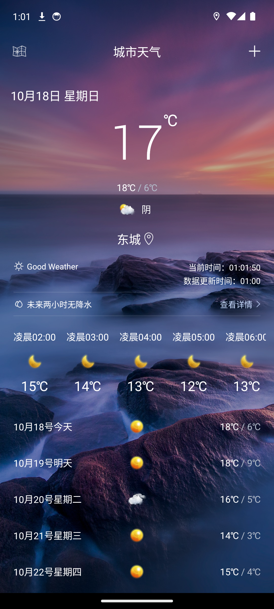
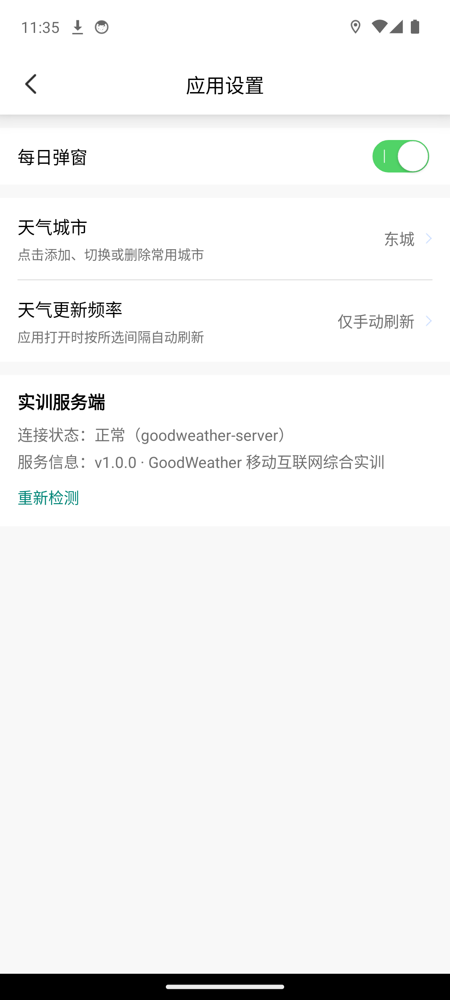
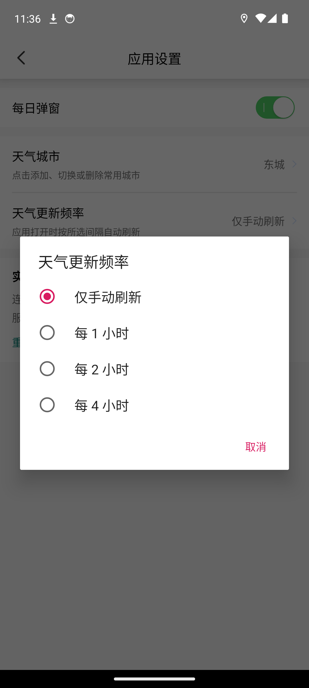
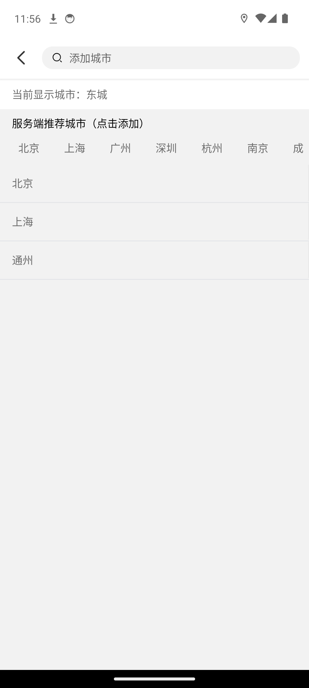
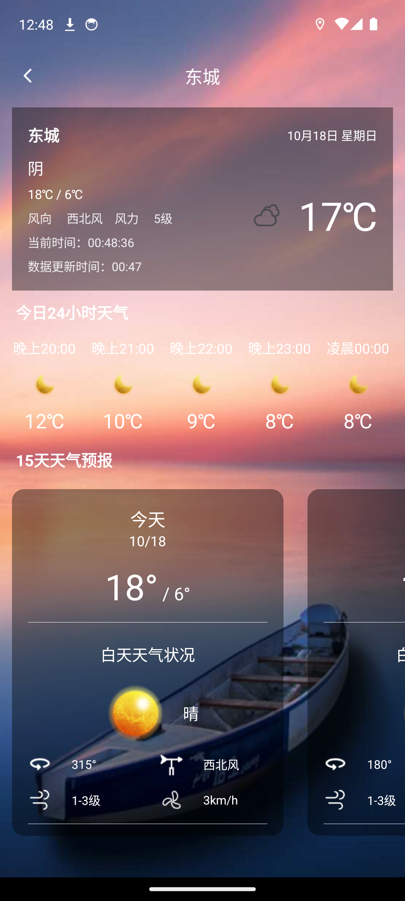

# GoodWeather 项目需求核对报告

> 核对日期：2026-10-18  
> 需求基准：`功能文档.md`  
> 主工程：`GoodWeather/GoodWeather-master/GoodWeather-master/`  
> 服务端：`weather-server/`

## 一、验收结论

**结论：核心需求与《功能文档.md》基本一致，判定为“有条件通过”。**

需求中的 Android 客户端、服务器端、启动界面、城市与更新频率设置、天气显示界面、天气详细界面均已有对应实现，并在 Android 14（API 34）模拟器上完成实际运行验证。首页成功显示东城区实时天气；设置页回显当前实际展示城市并提供更新频率设置；主页和详情页分别显示实时时钟与天气数据更新时间；详情页同时展示今日 24 小时天气和 15 天预报；主页和逐小时列表已使用清晰的彩色天气图标，已补齐的夜间代码 `151/152/350/351/456/457` 不再进入 `N/A` 兜底。

“有条件通过”是因为项目仍有以下工程问题：

1. 当前百度地图 AK 与本机 Debug SHA1 不匹配，日志返回鉴权错误 230；首页依靠系统定位兜底仍能工作，但百度地图和百度定位不能视为已正确部署。
2. `lintDebug` 未通过，共 7 个错误、894 个警告。
3. `connectedDebugAndroidTest` 因缺少 `androidx.test.ext:junit` 依赖而无法编译。
4. 声明支持 Android 5.0（minSdk 21），但启动流程对 API 21/22 存在兼容问题。

如果课程验收只检查《功能文档.md》列出的业务功能，本项目已满足；如果要求 Lint、设备测试和最低版本兼容全部通过，则尚未达到完全验收状态。

## 二、逐项核对

| 序号 | 需求项 | 实现证据 | 运行结果 | 判定 |
|---|---|---|---|---|
| 1 | 完整天气系统，包含 Android App 和服务器端 | Android 主工程包名为 `com.llw.goodweather`；Flask 提供 `/api/health`、`/api/info`、`/api/cities`；设置页支持编辑并持久化服务端地址 | 三个接口均返回 HTTP 200；App 可通过同一 Wi-Fi 连接电脑服务端 | 通过 |
| 2 | 启动界面 | `AndroidManifest.xml` 以 `SplashActivity` 为 Launcher；`SplashActivity` 完成权限申请、初始化并进入主页 | 冷启动成功，约 1 秒后进入 `MainActivity` | 通过（API 34） |
| 3 | 设置显示城市 | `SettingActivity` 回显当前实际展示城市并进入 `CommonlyUsedCityActivity`；支持搜索、常用城市和服务器推荐城市 | 设置页与主页均显示东城；城市管理页显示“当前显示城市”，并自动清理历史同名重复项 | 通过 |
| 4 | 设置更新频率 | 提供仅手动、1 小时、2 小时、4 小时四档；主页按 SharedPreferences 配置调度刷新 | 实测可从手动切换到每 1 小时并正确回显，验收后已恢复为手动 | 通过 |
| 5 | 显示日期、时间、城市、最高温、最低温、当前温度等 | `MainActivity` 绑定上述字段，并使用文字和 30dp 彩色天气图标显示；页面可见时每秒刷新时钟 | 实测显示日期、东城、当前/高低温、彩色天气图标、`当前时间 HH:mm:ss` 和独立的 `数据更新时间 HH:mm` | 通过 |
| 6 | 详细界面显示主页信息，并用列表显示当天情况 | `MoreDailyActivity` 顶部显示完整概要，下方分别请求 24 小时与 15 天数据 | 实测概要信息完整，“今日24小时天气”和“15天天气预报”两个横向列表同时显示并可滚动 | 通过 |

## 三、关键实现证据

### 1. 启动界面

- Launcher 配置：`app/src/main/AndroidManifest.xml`
- 启动逻辑：`app/src/main/java/com/llw/goodweather/ui/SplashActivity.java:55-175`
- 流程：权限申请 -> 初始化国家数据和启动资源 -> 延时进入主页
- 权限拒绝时仍允许进入应用，可通过搜索城市查询天气

### 2. 城市与更新频率设置

- 当前城市回显：`app/src/main/java/com/llw/goodweather/ui/SettingActivity.java:97-106`
- 设置入口与更新频率：`app/src/main/java/com/llw/goodweather/ui/SettingActivity.java:108-154`
- 更新频率常量：`app/src/main/java/com/llw/goodweather/utils/Constant.java:119-130`
- 自动刷新调度：`app/src/main/java/com/llw/goodweather/MainActivity.java:492-564`
- 城市管理：`app/src/main/java/com/llw/goodweather/ui/CommonlyUsedCityActivity.java`
- 城市选择后通过 `SearchCityEvent` 通知主页重新查询天气
- 主界面把实际展示城市写入独立配置，避免定位城市与上次手动城市回显不一致
- 城市列表阻止同名重复添加，并在加载时清理旧版本留下的同名重复记录
- 服务端推荐城市使用紧凑名称展示，搜索结果仍保留完整行政区信息
- 更新频率不是只保存设置，主页会按所选分钟数循环请求当前城市数据

### 3. 主页天气显示

- 核心请求入口：`MainActivity.java:1198-1227`
- 实时时钟与生命周期控制：`MainActivity.java:493-513`
- 实况字段绑定与主页彩色图标：`MainActivity.java:1273-1315`
- 最高/最低温及预报列表：`MainActivity.java:1323-1370`
- 详情页参数传递：`MainActivity.java:1028-1048`
- 主页图标尺寸：`app/src/main/res/layout/activity_main.xml:178-184`
- 彩色图标映射：`app/src/main/java/com/llw/goodweather/utils/WeatherUtil.java`

运行时实际显示：

- 日期：10 月 18 日 星期日
- 城市：东城
- 当前温度：17℃
- 最高/最低温：18℃ / 6℃
- 天气：阴，并显示 30dp 彩色天气图标
- 当前时间：按 `HH:mm:ss` 每秒更新
- 数据更新时间：独立显示为 `HH:mm`

图标修复结果：

- 主页当前天气从旧深色图标切换为 `WeatherUtil.changeIcon()` 彩色映射。
- 夜间多云/少云 `151/152` 采用方案 C，统一映射到高对比度 `icon_153`。
- 夜间阵雨/强阵雨/阵雨夹雪/阵雪 `350/351/456/457` 均已映射到有效资源，不再进入未知图标兜底。

### 4. 详细界面

- 概要信息与实时时钟：`app/src/main/java/com/llw/goodweather/ui/MoreDailyActivity.java:88-206`
- 24 小时与 15 天列表初始化：`MoreDailyActivity.java:211-236`
- 逐小时天气请求：`app/src/main/java/com/llw/goodweather/contract/MoreDailyContract.java:70-94`
- 两类预报数据分别绑定：`MoreDailyActivity.java:250-318`

详情页已显示主页要求的城市、日期、当前时间、数据更新时间、当前温度、最高温、最低温、天气文字和天气图片；“今日24小时天气”逐项显示时间、天气图标和温度；“15天天气预报”显示每天的昼夜天气、风向、风力和风速。

### 5. 服务器端

- 服务实现：`weather-server/app.py:32-56`
- Android 接口：`app/src/main/java/com/llw/goodweather/api/TrainingServerApi.java`
- 客户端探测：`app/src/main/java/com/llw/goodweather/utils/ServerClient.java`
- 地址校验：`app/src/main/java/com/llw/goodweather/utils/ServerUrlUtils.java`

实测接口：

| 接口 | HTTP 状态 | 核心结果 |
|---|---:|---|
| `/api/health` | 200 | `status=ok` |
| `/api/info` | 200 | 项目名与客户端包名正确 |
| `/api/cities` | 200 | `code=200`，返回 10 个推荐城市 |

说明：当前 Flask 是辅助服务端，负责健康检查、项目信息和推荐城市；天气数据由 App 直接请求和风天气。如果老师明确要求“所有天气数据必须经自建服务器转发”，这一点需要再改造。服务端地址可在设置页输入并持久化，手机与电脑同一 Wi-Fi 时可脱离数据线运行。

## 四、实际验证结果

| 检查项 | 结果 |
|---|---|
| Android Java 编译 | 通过 |
| Debug APK 打包 | 通过，生成 `GoodWeather2.5.apk`，31,696,548 bytes（约 30 MB） |
| 本地单元测试 | 通过 5 个，其中 3 个覆盖服务端地址补全、HTTPS 保留和非法地址拒绝 |
| Android 资源 XML 解析 | 通过 |
| Flask 接口测试 | 3/3 通过 |
| 和风 Geo 接口 | HTTP 200，返回 10 个城市 |
| 和风实况天气 | HTTP 200 |
| 和风 7 天预报 | HTTP 200，返回 7 天 |
| 和风 15 天预报 | HTTP 200，返回 15 天 |
| Android 14 模拟器启动 | 通过 |
| 首页核心字段 | 通过 |
| 主页实时时钟连续更新 | 通过，分别读取到 `23:33:41` 和 `23:34:11` |
| 设置页及服务端状态 | 通过；移除 `adb reverse` 后经 `10.110.61.220:5000` 连接正常 |
| 服务端地址规范化与持久化 | 通过；输入无协议地址后自动补全，强制停止并重启仍正确回显和连接 |
| 设置页当前城市与主页一致 | 通过，均为“东城” |
| 更新频率选项与保存 | 通过 |
| 城市管理、推荐城市及重复数据清理 | 通过 |
| 详情页当前天气概要 | 通过 |
| 详情页今日 24 小时列表 | 通过 |
| 详情页 15 天预报列表 | 通过 |
| 主页当前天气彩色图标 | 通过，容器 30dp |
| 夜间图标方案 C | 通过，`151/152` 显示清晰且不进入 `icon_999` 兜底 |
| 夜间雨雪代码映射 | 通过，已覆盖 `350/351/456/457` |
| 运行期间致命崩溃 | 未发现 `FATAL EXCEPTION` |
| Lint | 未通过：7 errors、894 warnings |
| 设备自动化测试 | 未通过：测试代码缺少 JUnit Runner 依赖 |

## 五、待处理问题

### 高优先级

1. **修复百度 LBS 鉴权**

   当前日志：

   ```text
   errorcode: 230
   msg: APP Mcode码校验失败
   ```

   需要在百度地图开放平台为包名 `com.llw.goodweather` 配置当前 Debug/Release 签名 SHA1。当前模拟器通过系统定位兜底获得东城天气，但地图和百度定位仍不可靠。

2. **处理 Android 5.0/5.1 启动兼容**

   `minSdk=21`，但 `SplashActivity.permissionVersion()` 在 API 21/22 只显示提示，没有调用进入应用的初始化方法；同时 `MainActivity` 标注要求 API 23。建议修复兼容逻辑，或把 `minSdk` 明确提高到 23。

3. **修复设备测试依赖**

   `ExampleInstrumentedTest` 引用了 `androidx.test.ext.junit.runners.AndroidJUnit4`，但 `app/build.gradle` 未声明 `androidx.test.ext:junit`，导致 `connectedDebugAndroidTest` 无法编译。

### 中优先级

4. **清理 Lint 错误**

   当前 7 个错误包括：

   - `app/src/main/res/mipmap-xhdpi.zip` 被放在资源目录中
   - API 21/22 调用 API 23 方法
   - 缺少 Android 13+ 通知权限声明
   - 两处 `Cursor.getColumnIndex()` 结果未检查 `-1`

5. **补充真实业务测试**

   当前已增加 3 个服务端地址规范化单元测试。仍建议继续覆盖：

   - 更新频率存取与调度
   - Flask 三个接口的数据结构
   - 和风响应为空或非 200 时的页面行为
   - 城市切换后主页字段更新
   - 详情页 Intent 数据缺失时的兜底请求

6. **增强网络异常判空**

   `MainActivity` 和 `MoreDailyActivity` 的部分回调在访问 `response.body().getCode()` 前没有统一判空。当前接口正常时不影响，但 HTTP 异常或响应体为空时可能触发空指针。

## 六、验收截图

### 首页



### 设置页



### 更新频率选项



### 城市管理



### 天气详细页



### 夜间图标方案 C


## 七、最终判断

项目已经实现需求文档规定的主要业务功能，客户端与服务端均能运行，核心页面和数据链路在 Android 14 模拟器上验证通过；城市一致性、双时间显示、详情页 24 小时列表、夜间图标清晰度和可配置局域网服务端地址均已完成。当前最需要补齐的不是需求功能，而是百度定位部署、最低版本兼容、Lint 清理和自动化测试配置。
